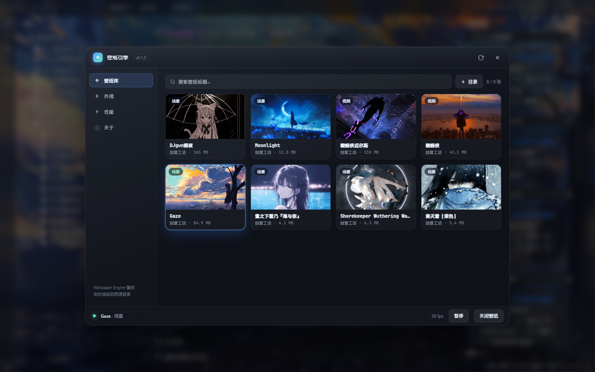
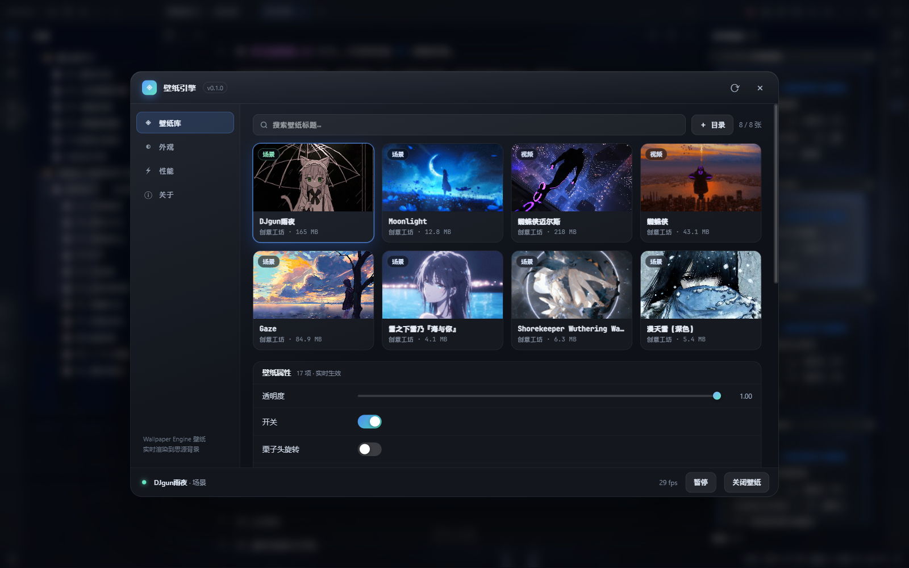
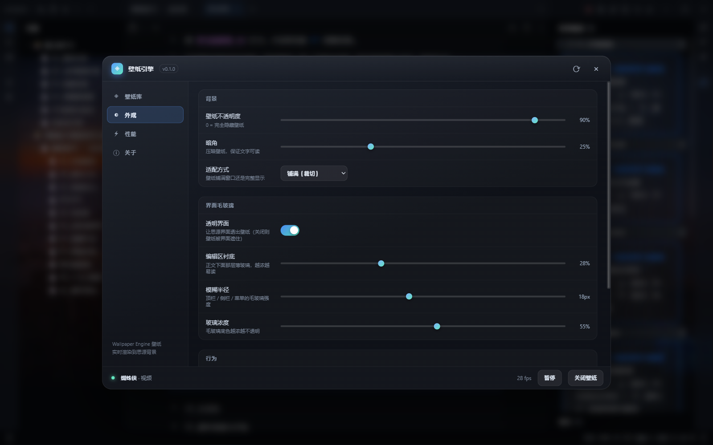

# SiYuan Wallpaper Engine

Play your local **Wallpaper Engine** wallpapers as a live background inside [SiYuan](https://b3log.org/siyuan/).

Scene wallpapers (`scene.pkg`) are rendered in real time with WebGL2 — layers, particles, effects and SceneScript all run. Video wallpapers stream with HTTP Range support; web wallpapers load in an iframe. A configurable liquid-glass layer keeps the editor readable on top.

> The SiYuan counterpart of [dsh-plugin-wallpaper-engine](https://github.com/elysia395/dsh-wallpaper-engine). Scene rendering is powered by [WebWallGL](https://github.com/oneincase/webwallgl) (MIT); this plugin adds the library, playback, appearance and SiYuan integration.



## Features

- **Library**: auto-discovers Steam Workshop `431960` and `myprojects`, plus any custom folder
- **Scene wallpapers**: parses `scene.pkg` directly and renders it — no screen recording, no transcoding
- **Video wallpapers**: streamed over a loopback HTTP server with Range requests; 4K / 200 MB+ works
- **Web wallpapers**: local static server + iframe, relative assets included
- **Wallpaper properties**: auto-generated controls from `project.json` `general.properties`


- **Liquid glass**: transparent UI, editor veil, blur radius, glass opacity, scrim, wallpaper opacity, fit mode
- **Full-transparent mode**: one switch to show the wallpaper at 100% with no scrim, veil, tint or background blur
- **Performance**: FPS cap, render DPR, live FPS, pause on blur
- **Rotation**: random switch every 5 / 15 / 30 / 60 minutes
- **Persistence**: remembers the last wallpaper and per-wallpaper properties

| Wallpaper type | Supported | Notes |
| --- | --- | --- |
| Scene `scene.pkg` | ✅ realtime | WebGL2, layers / particles / effects / scripts |
| Video | ✅ streaming | mp4 / webm / mov, 4K OK |
| Web | ✅ iframe | local static server |
| Image / GIF | ✅ | played as media wallpaper |
| Application | ❌ | compiled binary, cannot run in a browser engine |

## Install

1. Open SiYuan → `Settings` → `About` → `Workspace` and locate the workspace folder (e.g. `C:\Users\<you>\Documents\SiYuan\project`)
2. Extract the plugin into:

   ```
   <workspace>/data/plugins/siyuan-wallpaper-engine/
   ```

   `plugin.json` must sit directly in that folder.
3. Restart SiYuan, then enable **Wallpaper Engine** under `Settings` → `Marketplace` → `Downloaded` → `Plugins`
4. Click the wallpaper icon in the top bar (or press `Ctrl+Alt+W`)

Or grab `siyuan-wallpaper-engine-<version>.zip` from [Releases](https://github.com/lzjlzj-afk/siyuan-wallpaper-engine/releases).

## Quick start

1. Open the panel from the top bar (`Ctrl+Alt+W`)
2. Click a wallpaper — the background switches immediately
3. Tune **editor veil** and **scrim** until text is comfortable
4. Use **Close wallpaper** to return to the native look



## Where wallpapers live

- Steam Workshop: `...\steamapps\workshop\content\431960\<workshop id>\`
- Own projects: `...\steamapps\common\wallpaper_engine\projects\myprojects\`
- Custom folders containing `project.json` — add them with **＋ Folder**

The plugin parses Steam's `libraryfolders.vdf`, so libraries on other drives are found too.

## FAQ

**No wallpapers found.** Make sure Wallpaper Engine is installed and has at least one subscribed/created wallpaper. Right-click a wallpaper in WE → "Open in Explorer" to see the source folder, then add it with **＋ Folder**.

**Scene wallpapers are slow.** Lower FPS to 24 and DPR to 1.0. 4K scenes are heavy on integrated GPUs.

**Text is hard to read.** Raise the editor veil and scrim first, then lower wallpaper opacity.

**Transparent UI does nothing.** Some themes hard-code opaque backgrounds with `!important`. Try another theme or turn off "Transparent UI".

**Video wallpaper is black.** Use H.264/VP9 mp4/webm; HEVC may not decode.

## How it works

- The plugin reads wallpaper files with Node `fs` in the renderer and runs a loopback-only static server (with Range support) for video/web wallpapers
- Scene packages are read as an `ArrayBuffer` and handed to WebWallGL
- The background is a fixed `#wpgl-bg` layer at `z-index: -1`; a set of CSS overrides under `html.wpgl-on` makes SiYuan's panels transparent and adds `backdrop-filter`

## Development

No build step: `index.js` + `lib/*.js` are the runtime.

```bash
node tools/test-scan.js            # wallpaper scanning only
node tools/preview-server.js       # local preview at http://127.0.0.1:7801/
node tools/shot.js <url> <out.png> # headless screenshot
```

## Credits

- [WebWallGL](https://github.com/oneincase/webwallgl) — Wallpaper Engine scene renderer (MIT)
- [dsh-plugin-wallpaper-engine](https://github.com/elysia395/dsh-wallpaper-engine) — interaction and visual inspiration
- Wallpaper assets belong to their authors; the plugin only reads local files

## License

MIT © 2026 lzjlzj-afk
