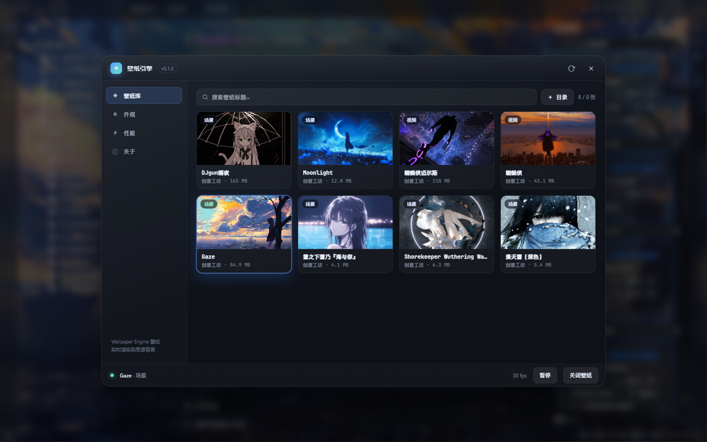
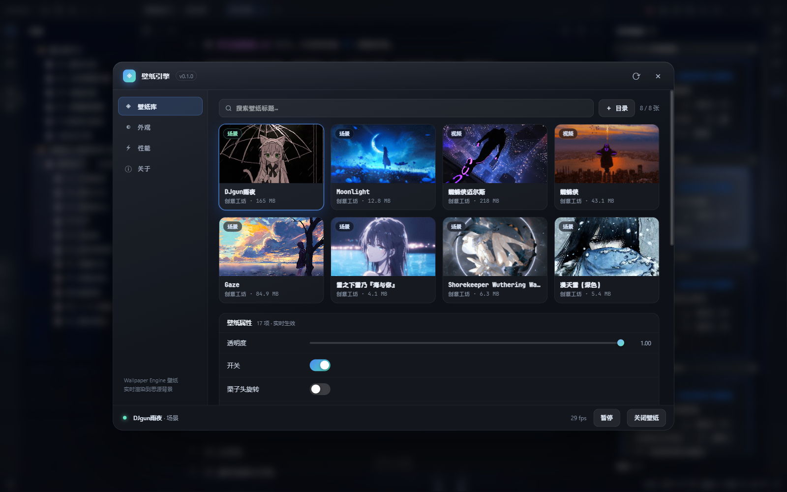
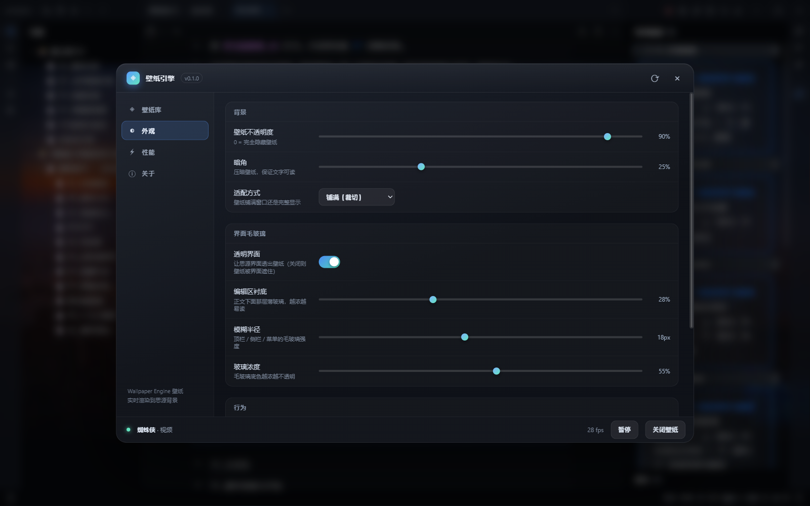

# 思源壁纸引擎 · SiYuan Wallpaper Engine

把 **Wallpaper Engine** 的本地壁纸变成思源笔记的实时背景。

场景壁纸（`scene.pkg`）用 WebGL2 逐帧还原图层、粒子、效果与 SceneScript；视频壁纸按需流式播放；网页壁纸用 iframe 承载。再配一层可调的毛玻璃，让笔记界面和动态壁纸真正融在一起。

> 与 [dsh-plugin-wallpaper-engine](https://github.com/elysia395/dsh-wallpaper-engine) 同一思路的思源版本：场景渲染交给 [WebWallGL](https://github.com/oneincase/webwallgl)（MIT），插件负责壁纸库、播放、外观与思源界面融合。



## 功能

- **壁纸库**：自动发现 Steam 创意工坊 `431960` 与 `myprojects`，也能添加任意本地壁纸目录
- **场景壁纸实时渲染**：`scene.pkg` 直接解析，不走"录屏/转视频"，粒子、时钟、脚本都能动
- **视频壁纸**：本地 HTTP Range 流式播放，4K / 200MB+ 也不用整段读进内存
- **网页壁纸**：本地静态服务 + iframe，支持相对路径资源
- **壁纸属性**：读取 `project.json` 的 `general.properties`，自动生成滑条 / 开关 / 颜色 / 下拉控件


- **毛玻璃外观**：透明界面、编辑区衬底、模糊半径、玻璃浓度、暗角、壁纸不透明度、适配方式
- **全透明模式**：一键让壁纸 100% 透出，去掉暗角 / 衬底 / 玻璃底色 / 背景模糊
- **性能控制**：帧率上限、渲染精度、实时 FPS、失焦自动暂停
- **自动轮播**：5 / 15 / 30 / 60 分钟随机切换
- **记忆状态**：记住上次用的壁纸、每张壁纸调过的属性

| 壁纸类型 | 支持 | 说明 |
| --- | --- | --- |
| 场景 `scene.pkg` | ✅ 实时渲染 | WebGL2，图层 / 粒子 / 效果 / 脚本 |
| 视频 `video` | ✅ 流式播放 | mp4 / webm / mov，支持 4K |
| 网页 `web` | ✅ iframe | 本地静态服务，支持相对路径 |
| 图片 / GIF | ✅ | 作为媒体壁纸播放 |
| 程序 `application` | ❌ | 编译产物，浏览器环境无法运行 |

## 安装

### 方式一：手动安装（当前推荐）

1. 打开思源 → `设置` → `关于` → `工作空间`，找到工作空间目录（例如 `C:\Users\<你>\Documents\SiYuan\project`）
2. 把本仓库的插件文件解压到：

   ```
   <工作空间>/data/plugins/siyuan-wallpaper-engine/
   ```

   确保 `plugin.json` 就在这一层。
3. 重启思源（或刷新界面），到 `设置` → `集市` → `已下载` → `插件` 里启用「壁纸引擎」
4. 顶栏出现壁纸图标，点它打开面板

> 如果集市里看不到，检查 `data/plugins/siyuan-wallpaper-engine/plugin.json` 是否存在、名称是否为 `siyuan-wallpaper-engine`。

### 方式二：从 Release 安装

在 [Releases](https://github.com/lzjlzj-afk/siyuan-wallpaper-engine/releases) 下载 `siyuan-wallpaper-engine-<版本>.zip`，解压后按方式一放到 `data/plugins/` 下。

## 快速开始

1. 点顶栏的壁纸图标（或按 `Ctrl+Alt+W`）
2. 在「壁纸库」里点一张壁纸 —— 背景立即切换
3. 到「外观」调 **编辑区衬底** 和 **暗角**，找到文字清晰度和壁纸观感的平衡
4. 不满意就点右下角 **关闭壁纸**，一键回到原生外观



## 设置说明

| 设置 | 作用 | 建议 |
| --- | --- | --- |
| 全透明模式 | 壁纸 100%，去掉暗角 / 衬底 / 玻璃底色 | 想要"壁纸完全透出来"时开 |
| 壁纸不透明度 | 整张壁纸的强度，**数值越小越透明** | 0.55–0.75 |
| 暗角 | 压暗壁纸四周，保证文字可读 | 0.2–0.4 |
| 适配方式 | 铺满（裁切）/ 完整显示 / 拉伸 | 铺满 |
| 透明界面 | 关掉后壁纸只在界面背后，不参与融合 | 开 |
| 编辑区衬底 | 正文下面那层薄玻璃 | 0.25–0.35 |
| 模糊半径 | 顶栏 / 侧栏 / 菜单的毛玻璃强度 | 12–24px |
| 玻璃浓度 | 毛玻璃底色浓度 | 0.5–0.7 |
| 帧率上限 | 渲染帧率 | 笔记本 24–30 |
| 渲染精度 | 画布 DPR | 1.0–1.5 |
| 失焦时暂停 | 切走窗口自动停渲染 | 开 |
| 运行壁纸脚本 | 是否执行 SceneScript | 开 |
| 自动轮播 | 定时随机换壁纸 | 按需 |

## 壁纸从哪来

- **Steam 创意工坊**：Wallpaper Engine 订阅的壁纸，路径
  `...\steamapps\workshop\content\431960\<创意工坊 ID>\`
- **我的项目**：`...\steamapps\common\wallpaper_engine\projects\myprojects\`
- **自定义目录**：任何包含 `project.json` 的壁纸文件夹，点「＋ 目录」添加

插件会自动解析 Steam 的 `libraryfolders.vdf`，装在 D 盘 / E 盘的库也能找到。

## 常见问题

**找不到壁纸？**
确认 Wallpaper Engine 已安装且至少订阅/创建过壁纸；在 WE 里右键壁纸 →「在资源管理器中打开」可以看到源目录。也可以手动「＋ 目录」指向它。

**场景壁纸很卡 / 显存占用高？**
把帧率降到 24、渲染精度降到 1.0。4K 场景（`scene.json` 里 3840×2160）在核显上会比较吃力。

**文字看不清？**
优先调「编辑区衬底」和「暗角」，其次降低「壁纸不透明度」。不同主题的底色不一样，需要微调。

**透明界面没效果 / 界面变成一块块？**
部分主题给面板写死了 `!important` 背景。可以换一个主题，或在「外观」里关掉「透明界面」只用壁纸不透明度。

**视频壁纸黑屏？**
确认文件是 H.264/VP9 的 mp4/webm；HEVC 或特殊编码可能无法解码。也可以先用 HandBrake 转成 H.264。

**关掉插件后界面回不来？**
插件卸载/停用时会自动移除 `wpgl-on` 类，恢复原生外观；如果异常残留，重启思源即可。

## 工作原理

```
┌─────────────┐   扫描    ┌──────────────┐
│ Steam 库     │ ────────▶ │ 壁纸库 items  │
└─────────────┘           └──────┬───────┘
                                 │ 选中
        ┌────────────────────────▼────────────────────────┐
        │ WebWallGL.mount(stage, { source })               │
        │  ├─ scene.pkg → bytesSource(ArrayBuffer)         │
        │  ├─ video     → mediaSource(http Range URL)      │
        │  └─ web       → httpSource(本地静态目录)          │
        └────────────────────────┬────────────────────────┘
                                 │ WebGL2 画布
                    ┌────────────▼────────────┐
                    │ #wpgl-bg (z-index: -1)  │
                    │  + #wpgl-scrim 暗角      │
                    └────────────┬────────────┘
                                 │ 透出
                    ┌────────────▼────────────┐
                    │ 思源界面（透明 + 毛玻璃） │
                    └─────────────────────────┘
```

- 插件在渲染进程里用 Node 的 `fs` 读壁纸文件，起一个只监听 `127.0.0.1` 的静态服务（支持 Range），供视频 / 网页壁纸使用
- 场景壁纸直接读 `scene.pkg` 为 `ArrayBuffer`，交给 WebWallGL 解析并渲染
- 背景层是 `position: fixed; z-index: -1` 的 `#wpgl-bg`，配合 `html.wpgl-on` 下的一组 CSS 覆盖，让思源各面板透明并加 `backdrop-filter`

## 开发

```bash
git clone https://github.com/lzjlzj-afk/siyuan-wallpaper-engine
cd siyuan-wallpaper-engine
# 没有构建步骤：index.js + lib/*.js 就是运行时
```

调试脚本在 `tools/`：

- `node tools/test-scan.js`：只测壁纸库扫描
- `node tools/preview-server.js`：起本地预览（`http://127.0.0.1:7801/`）
- `node tools/shot.js <url> <out.png>`：无头浏览器截图
- `node tools/siyuan-test.js`：往真实思源页面注入背景层做视觉验证

## 致谢

- [WebWallGL](https://github.com/oneincase/webwallgl)：Wallpaper Engine 场景渲染核心（MIT）
- [dsh-plugin-wallpaper-engine](https://github.com/elysia395/dsh-wallpaper-engine)：交互与外观设计的灵感来源
- Wallpaper Engine 壁纸版权归各自作者所有，本插件只读取本机文件，不再分发

## 许可

MIT © 2026 lzjlzj-afk
