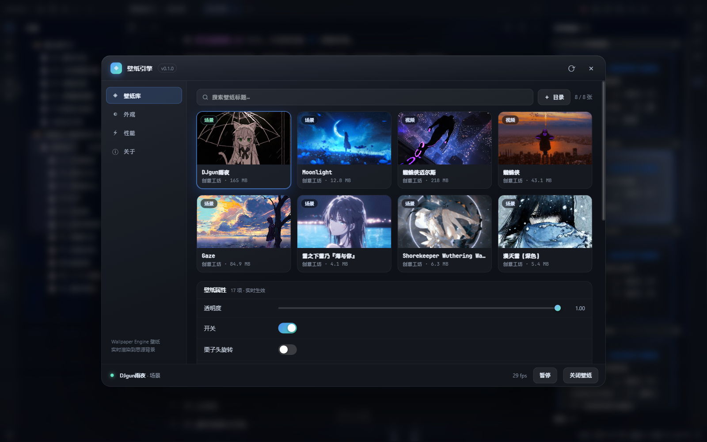
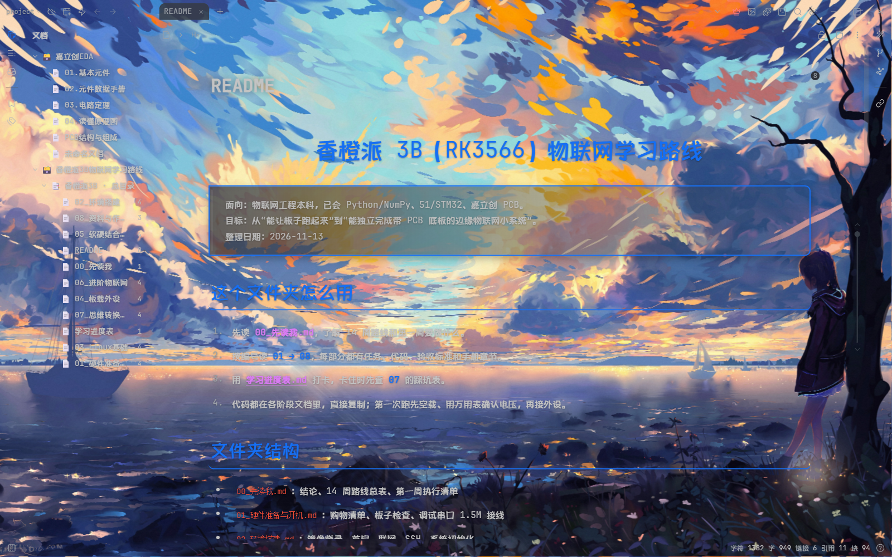

# 思源壁纸引擎 · 完整攻略

> 把 Wallpaper Engine 的本地壁纸接进思源笔记，做成实时动态背景。
> 适用版本：v0.1.0 · 思源 3.5+ 桌面端（Windows / macOS / Linux）

---

## 目录

1. [十分钟上手](#十分钟上手)
2. [准备工作：壁纸从哪来](#准备工作壁纸从哪来)
3. [安装插件](#安装插件)
4. [面板详解](#面板详解)
5. [调参口诀](#调参口诀)
6. [三类壁纸的玩法](#三类壁纸的玩法)
7. [性能与省电](#性能与省电)
8. [排错手册](#排错手册)
9. [卸载与回滚](#卸载与回滚)
10. [进阶技巧](#进阶技巧)
11. [常见问题](#常见问题)

---

## 十分钟上手

**第 1 分钟**：确认 Wallpaper Engine 能正常播放壁纸。打开 Steam → Wallpaper Engine → 「已安装」，右键任意壁纸 →「在资源管理器中打开」，记下这个目录。

**第 3 分钟**：安装插件（见下文），重启思源，顶栏会出现一个山与太阳的图标。

**第 5 分钟**：点图标打开面板。左边是「壁纸库」，里面应该已经列出你订阅的所有壁纸，每张都有预览图、类型标签和体积。

**第 7 分钟**：点一张**场景**壁纸。等 1–3 秒（大包会久一点），背景就换成实时渲染的动态壁纸了。

**第 9 分钟**：切到「外观」，把「编辑区衬底」拉到 30% 左右、「暗角」拉到 25% 左右。文字立刻清晰。

**第 10 分钟**：按 `Esc` 关面板，正常记笔记。想换壁纸随时 `Ctrl+Alt+W`。

---

## 准备工作：壁纸从哪来

插件读的是 Wallpaper Engine **本机文件**，所以先要有一份壁纸库。三种来源：

| 来源 | 路径 | 说明 |
| --- | --- | --- |
| 创意工坊 | `...\steamapps\workshop\content\431960\<ID>\` | 订阅的壁纸，最常见 |
| 我的项目 | `...\steamapps\common\wallpaper_engine\projects\myprojects\` | 自己在 WE 编辑器里做的 |
| 自定义 | 任意目录 | 只要里面（或一级子目录）有 `project.json` |

小技巧：在 WE 里右键壁纸 →「在资源管理器中打开」，就是它在磁盘上的真实位置。

插件会自动做这些事：

1. 从注册表读 Steam 安装路径
2. 解析 `libraryfolders.vdf`，把 D 盘 / E 盘的库也找出来
3. 扫描 `431960` 与 `myprojects`
4. 读取每个目录的 `project.json`，判断类型（scene / video / web / application），找预览图、找 `scene.pkg`、算体积

所以大多数情况下你**不需要手动加目录**。只有壁纸放在 NAS、移动硬盘或非标准目录时，才用面板里的「＋ 目录」。

---

## 安装插件

### 1. 找到工作空间

思源 → `设置` → `关于` → `工作空间`，复制路径。Windows 默认类似：

```
C:\Users\<用户名>\Documents\SiYuan\project
```

> 注意：是**工作空间**目录（里面有 `conf/`、`data/`），不是思源安装目录。

### 2. 放入插件

把插件文件夹放到：

```
<工作空间>\data\plugins\siyuan-wallpaper-engine\
```

放好后结构应该是：

```
data\plugins\siyuan-wallpaper-engine\
├─ plugin.json
├─ index.js
├─ index.css
├─ icon.png
├─ lib\
│  ├─ wp-core.js
│  ├─ wp-ui.js
│  └─ webwallgl.global.min.js
└─ i18n\
```

**关键检查**：`plugin.json` 必须在这一层。如果变成 `...\siyuan-wallpaper-engine\siyuan-wallpaper-engine\plugin.json`，插件不会加载。

### 3. 启用

重启思源（完全退出再打开，不是关窗口）。然后：

`设置` → `集市` → `已下载` → `插件` → 找到「壁纸引擎」→ 启用

启用后顶栏立刻出现图标；如果没出现，`Ctrl+Shift+I` 打开开发者工具看 Console 里有没有 `[wallpaper-engine]` 开头的报错。

### 4. 验证

- 顶栏图标 → 打开面板 → 「壁纸库」里能看到壁纸缩略图 = 扫描成功
- 点一张场景壁纸 → 背景变化 = 渲染成功
- 「性能」页 FPS 在 24–60 之间跳动 = 渲染循环正常

---

## 面板详解

面板分四个标签页。

### 壁纸库

- **搜索框**：按标题、类型、来源过滤
- **＋ 目录**：添加自定义壁纸根目录；添加后会重新扫描
- **⟳**：重新扫描（新订阅了壁纸就点它）
- **卡片**：左上角标签是类型（场景 / 视频 / 网页），下方是来源和体积
- **蓝色高亮**：当前正在用的壁纸
- **壁纸属性**：如果这张场景壁纸的 `project.json` 里带 `general.properties`，底部会自动出现「壁纸属性」，滑条 / 开关 / 颜色 / 下拉都能实时生效



点卡片 = 立即切换。切换时会先销毁旧实例再挂新的，大包会有短暂加载动画。

### 外观

| 项 | 说明 |
| --- | --- |
| 壁纸不透明度 | 整张壁纸的透明度，0 = 看不见壁纸 |
| 全透明模式 | 一键壁纸 100%，去掉暗角 / 衬底 / 玻璃底色 / 背景模糊（滑条会置灰） |
| 暗角 | 全屏压暗，四周更暗，是保证文字可读的第一道保险 |
| 适配方式 | 铺满（裁切）/ 完整显示 / 拉伸 |
| 透明界面 | 总开关。关掉后壁纸只在界面背后，不参与融合 |
| 编辑区衬底 | 正文下面那层薄玻璃，**最影响可读性** |
| 模糊半径 | 顶栏、侧栏、菜单的 `backdrop-filter` 强度 |
| 玻璃浓度 | 毛玻璃底色的不透明度 |
| 失焦时暂停 | 切到别的窗口自动停渲染，省电 |
| 运行壁纸脚本 | 关掉可省性能，但时钟、交互类壁纸会静止 |
| 自动轮播 | 5 / 15 / 30 / 60 分钟随机换一张 |

### 性能

- **帧率上限**：15 / 24 / 30 / 60。实测 30 fps 最平衡
- **渲染精度**：1.0× / 1.25× / 1.5× / 2.0×。1.5× 在 1080p 屏上已经足够清晰
- **实时帧率**：当前真实 FPS，低于 20 说明该降档了
- **显卡**：通过 `WEBGL_debug_renderer_info` 读到的渲染器名称

### 关于

版本、引擎信息、快捷键、版权提示。

---

## 调参口诀

> **先衬底，再暗角，最后降透明度。**

1. **文字糊在壁纸上** → 编辑区衬底 25% → 35%
2. **还是花** → 暗角 25% → 40%
3. **壁纸太抢眼** → 壁纸不透明度 65% → 50%
4. **界面太闷** → 玻璃浓度 55% → 45%，模糊 18px → 12px
5. **卡** → 帧率 24，精度 1.0，模糊 12px

不同主题的底色差别很大：浅色主题（如 onelight）建议衬底 30% 左右、暗角 15%；深色主题建议衬底 25%、暗角 30%。

一个反直觉的点：**暗角不是越高越好**。太高会把壁纸压成灰蒙蒙一片，反而失去意义。优先用衬底解决正文，暗角只负责压四周。

---

## 全透明模式

想要壁纸**完全透出来**（不压暗、不加衬底、不糊），打开「外观 → 背景 → 全透明模式」：

- 壁纸不透明度强制 100%
- 暗角、编辑区衬底、玻璃底色、背景模糊全部归零
- 相关滑条会置灰锁定，关掉开关后恢复你原来的数值

代价是文字直接压在壁纸上：亮色壁纸（比如海边日落、雪景）会明显难读。



折中方案：不开全透明，把「壁纸不透明度」拉到 85–100%，只保留 5–10% 的「编辑区衬底」。这样壁纸几乎完整，正文又有一层极薄的底。

---

## 三类壁纸的玩法

### 场景壁纸（scene.pkg）

WE 里最主流的类型，也是本插件的核心。`scene.pkg` 是一个打包了 `scene.json`、贴图、模型、shader 的容器，插件把它整个读进内存交给 WebWallGL 解析。

- 能还原：图层变换、粒子（雪 / 雨 / 火花）、后处理效果、相机视差、SceneScript（时钟、点击交互）、用户属性
- 不能还原：WE 独有的一些高级特性（极少数）、音频可视化（默认静音 + 模拟频谱）
- 体积：几 MB 到几百 MB 都有；100MB+ 的包首次加载约 1–3 秒

**场景壁纸最吃 GPU**。4K 场景 + 60fps 在核显上会明显掉帧，建议 30fps + 1.25×。

### 视频壁纸

WE 的视频壁纸就是一个 mp4/webm，插件用本地 HTTP 服务 + Range 请求流式播放，不会把 200MB 整段读进内存。

- 支持格式：H.264 / VP9 的 mp4、webm；HEVC 可能黑屏
- 声音默认关闭（背景壁纸出声很吵，也避免自动播放策略问题）
- 想换视频：直接把文件替换掉，重新扫描即可

### 网页壁纸

WE 的 web 壁纸是 HTML/JS。插件会为本机壁纸目录起一个只监听 `127.0.0.1` 的静态服务，再用 iframe 加载 `index.html`，相对路径的 js/css/图片都能正常加载。

- 依赖网络的网页壁纸需要联网
- 网页壁纸里的鼠标交互在思源里可用（指针事件透传）
- 少数网页壁纸会检测 WE 环境，可能显示不全

### 图片 / GIF

`project.type` 为图片的类型（部分 WE 版本）走媒体通道直接播放；GIF 会循环。

### 程序壁纸（application）

WE 里用可执行程序做的壁纸，无法在浏览器环境运行，插件会把它标灰、不可点击。

---

## 性能与省电

| 场景 | 建议 |
| --- | --- |
| 台式机 + 独显 | 30–60fps，1.5×–2.0× |
| 笔记本插电 | 30fps，1.25×–1.5× |
| 笔记本电池 | 24fps，1.0×，开「失焦暂停」 |
| 4K 屏 | 1.25×，30fps；别用 2.0× |
| 核显 + 4K 场景 | 24fps，1.0×，考虑换 1080p 壁纸 |

省电三件套：**失焦暂停 + 24fps + 1.0× 精度**。实测比默认设置 GPU 占用低一半以上。

另外：

- 场景壁纸比视频壁纸更吃 GPU（每帧都要跑 shader）
- 粒子多的场景（雪、雨、DJgun 雨夜）比静态场景更吃 CPU
- 关掉「运行壁纸脚本」能省一点 CPU，但时钟类壁纸会停

---

## 排错手册

### 面板里一张壁纸都没有

1. 确认 WE 已安装且至少有一张壁纸
2. 打开 `设置` → `关于` → `工作空间`，确认 `data/plugins/siyuan-wallpaper-engine/` 存在
3. 看 Console（`Ctrl+Shift+I`）有没有 `[wallpaper-engine] scan failed`
4. 在面板点「＋ 目录」，手动粘贴 WE 壁纸目录（右键壁纸 →「在资源管理器中打开」的路径）

### 有卡片但缩略图是裂的

缩略图通过本地 HTTP 服务加载。检查：

- 端口是否被占用（插件会自动换端口，一般不会）
- 防火墙是否拦截了 `127.0.0.1` 的随机端口（极少见）
- 点卡片能正常播放的话，缩略图裂只是图片格式问题（webp/avif），可以忽略

### 点壁纸没反应 / 一直转圈

- 打开 Console 看报错。`Wallpaper package cannot be opened` = pkg 损坏，重新下载壁纸
- 场景壁纸特别大（>300MB）时首次解析会久，等 5–10 秒
- 视频壁纸黑屏 = 编码不支持，用 HandBrake 转 H.264

### 界面透明了但文字看不清

按「调参口诀」来。另外：

- 浅色主题 + 亮色壁纸是最难组合，建议换深色主题
- 某些主题给 `.protyle` 写了 `!important` 背景，插件覆盖不掉，只能换主题

### 顶栏没有图标

- 插件没启用：`设置` → `集市` → `已下载` → `插件` → 启用
- 插件加载失败：Console 里搜 `wallpaper-engine`，常见原因是 `lib/webwallgl.global.min.js` 缺失
- 图标被顶栏折叠：窗口太窄时部分图标会进「更多」

### 更新思源后插件消失

思源升级不会删 `data/plugins`，但如果你换了工作空间，插件不在新工作空间里。把文件夹复制过去即可。

### 关掉壁纸后界面还是透明的

插件卸载时会移除 `wpgl-on` 类。如果异常残留：

1. 面板 →「关闭壁纸」
2. 还不行就重启思源
3. 再不行，`Ctrl+Shift+I` → Console 执行 `document.documentElement.classList.remove('wpgl-on')`

---

## 卸载与回滚

**临时关闭**：面板右下角「关闭壁纸」——壁纸停掉，界面恢复。

**停用插件**：`设置` → `集市` → `已下载` → `插件` → 关闭开关，重启思源。

**彻底删除**：停用后删除 `data/plugins/siyuan-wallpaper-engine/` 整个目录。

**恢复原生外观**：插件会移除 `wpgl-on` 类；主题、字体等设置不受影响。

---

## 进阶技巧

### 1. 用 OBS 把场景壁纸录成视频

如果你想要"场景壁纸的观感 + 视频壁纸的低占用"：

1. WE 里右键壁纸 →「窗口内播放」
2. OBS 窗口捕获那个窗口，录 30–60 秒
3. 用 HandBrake 转成 H.264、1080p、30fps、5–8 Mbps
4. 放到一个自定义目录，面板「＋ 目录」添加

这样能得到接近原始的观感，同时 GPU 占用降到视频解码级别。

### 2. 给不同壁纸配不同衬底

插件目前是全局外观设置。想要"这张壁纸亮、那张壁纸暗"分开调，可以配合思源的**代码片段**（`设置` → `外观` → `代码片段`）覆盖 `--wpgl-veil` 等变量。

### 3. 多显示器

插件只覆盖思源窗口，不影响桌面壁纸。想桌面也是同一张，WE 那边照常设置即可。

### 4. 搭配深色主题

深色主题 + 暗色壁纸 + 玻璃浓度 60% 是观感最稳的组合；浅色主题建议降低暗角、提高衬底。

### 5. 壁纸属性玩法

部分场景壁纸（如 DJgun雨夜）自带「透明度」「位置 X/Y」「屏幕雨滴」等属性。面板底部的「壁纸属性」会实时改这些值，等于把 WE 的属性面板搬进了思源。

---

## 常见问题

**Q：会不会把壁纸上传到网上？**
不会。插件只读本机文件，起的 HTTP 服务只监听 `127.0.0.1`，不对外网开放。

**Q：支持移动端吗？**
不支持。移动端没有 Node `fs`，读不了本地壁纸文件，插件只在前端桌面端加载。

**Q：会不会和 background-cover 插件冲突？**
会。两个插件都想控制背景层。用其中一个就行。

**Q：壁纸会跟着思源同步吗？**
不会。壁纸是本地文件，同步的只有"上次用了哪张"这个记录。

**Q：为什么有时候 FPS 显示 0？**
窗口失焦、被遮挡、或壁纸暂停时会归零，属于正常现象。

**Q：能自定义快捷键吗？**
`设置` → `快捷键` → 搜索「壁纸引擎」，默认 `Ctrl+Alt+W`。

---

## 版本

- v0.1.0：首个版本。壁纸库、场景/视频/网页/图片播放、毛玻璃外观、属性面板、轮播、失焦暂停。

有问题欢迎到 [Issues](https://github.com/lzjlzj-afk/siyuan-wallpaper-engine/issues) 反馈，附上：

1. 思源版本、系统版本
2. 壁纸类型和大概体积
3. Console 里 `[wallpaper-engine]` 开头的日志
